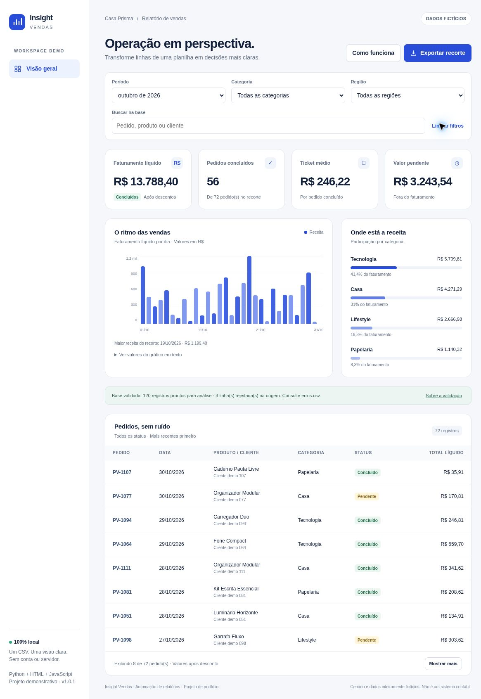

# Insight Vendas

**Um CSV de vendas entra. Um relatório pronto para explorar sai.**

Automação em Python que valida um CSV de vendas e transforma os registros em um painel HTML interativo. Para explorar o exemplo, basta um navegador. Para gerar novos relatórios, use Python 3.11 ou superior, sem pacotes adicionais.

> Projeto demonstrativo de portfólio. Casa Prisma, seus produtos, compradores e valores são fictícios. Não representa cliente atendido nem resultado comercial real. O painel funciona localmente, sem uma versão hospedada.

## Experimente sem instalar

1. No topo do repositório, selecione **Code → Download ZIP**.
2. Extraia a pasta baixada.
3. Abra **`dist/index.html`** no seu navegador.

O exemplo reúne o painel e os 120 pedidos fictícios válidos em um único arquivo, que funciona sem internet. Abrir o arquivo diretamente no GitHub mostra o código-fonte, não executa o painel.



*Captura real do painel desktop da versão 1.0.1. A apresentação mobile ainda não foi verificada.*

- Explore período, categoria e região.
- Busque produto, cliente fictício ou número do pedido.
- Compare faturamento, pedidos concluídos, ticket médio e valores pendentes.
- Exporte o recorte em CSV, incluindo as linhas que não aparecem na primeira página da tabela.
- Use **Como funciona** para consultar as fórmulas, regras e limites.

O painel abre no mês mais recente. **Limpar filtros** mostra toda a base. A pasta também inclui os dados tratados, o resumo estruturado e o relatório de rejeições.

**Verificação:** 27 testes Python passaram. O layout desktop da versão 1.0.1 foi revalidado; **QA mobile ainda pendente**. Consulte [o relatório de testes](docs/TESTES.md) para os fluxos verificados e a aba [Actions](https://github.com/felipericci1993/insight-vendas/actions) para o resultado de cada commit.

**Navegue:** [Gerar um relatório](#gerar-um-relatório) · [Formato de entrada](#formato-de-entrada) · [Testes](#testes) · [Privacidade](#privacidade-e-segurança)

## Qual problema resolve

Exportações de planilhas costumam exigir as mesmas tarefas: verificar campos, evitar pedidos duplicados, conferir valores e produzir um resumo compreensível. Este projeto concentra essas etapas em um comando e deixa as linhas rejeitadas rastreáveis.

O projeto demonstra **automação de relatórios, tratamento de CSV e dashboard web**: validar os dados de vendas e gerar um relatório que pode ser aberto no navegador.

## Gerar um relatório

Requisito: **Python 3.11 ou superior**. Execução validada com Python 3.12.14. Não há pacotes obrigatórios para instalar.

Na pasta deste projeto:

```bash
python -m insight_vendas data/vendas_demo.csv --output meu-relatorio
```

Em alguns sistemas, o comando é `python3` ou `py`.

Abra `meu-relatorio/index.html`. Para impedir a geração se houver qualquer linha inválida:

```bash
python -m insight_vendas data/modelo.csv --output relatorio-estrito --strict
```

O arquivo `data/vendas_demo.csv` tem três erros deliberados; por isso ele **deve falhar no modo estrito**. Use `data/modelo.csv` para começar uma base válida.

```bash
python -m insight_vendas --help
python -m insight_vendas --version
```

O comando substitui os quatro arquivos gerados caso eles já existam na pasta escolhida. Não edite esses arquivos à mão: altere a entrada e gere uma nova versão. Prefira uma pasta nova para preservar relatórios anteriores. O arquivo de entrada não pode ser um dos destinos de saída.

## Arquivos produzidos

| Arquivo | Uso |
| --- | --- |
| `index.html` | Painel offline com filtros, indicadores, gráficos e exportação |
| `resumo.json` | Metadados, indicadores em centavos e todos os registros válidos |
| `vendas_tratadas.csv` | Base normalizada com total líquido de cada pedido |
| `erros.csv` | Número da linha, identificador e primeiro motivo de rejeição |

Os CSVs exportados usam UTF-8 com BOM, ponto e vírgula e decimais com vírgula. Campos que poderiam ser interpretados como fórmulas recebem um apóstrofo inicial. O CSV tratado inclui a coluna calculada `total_liquido`; ele é uma **saída**, não uma entrada pronta para reprocessamento.

## Formato de entrada

CSV UTF-8, separado por **ponto e vírgula**. Colunas obrigatórias, sem outras colunas ou duplicação do cabeçalho:

```text
pedido_id;data;cliente;produto;categoria;regiao;quantidade;preco_unitario;desconto_pct;status
```

| Campo | Regra |
| --- | --- |
| `pedido_id` | Identificador único por pedido, até 50 caracteres |
| `data` | `AAAA-MM-DD` ou `DD/MM/AAAA`, de 2000 a 2099 |
| `cliente`, `produto`, `categoria`, `regiao` | Texto obrigatório, até 120 caracteres |
| `quantidade` | Inteiro de 1 a 1.000 |
| `preco_unitario` | De 0 a 100.000, até duas casas, sem separador de milhar |
| `desconto_pct` | De 0 a 100, até duas casas |
| `status` | `concluido`, `pendente` ou `cancelado`; aceita `concluído` |

Regras adicionais:

- Uma linha representa **um pedido com um produto**, não um item de pedido com vários produtos.
- A primeira ocorrência **válida** de um identificador é mantida. As demais são rejeitadas, mesmo com status diferente. Não representa histórico de mudanças de status.
- Linhas inválidas não entram em nenhum indicador. A base não é corrigida silenciosamente.
- Datas e números são validados; espaços externos são removidos. Quantidades fracionárias, notação científica e separadores de milhar não são aceitos.
- Máximo de 10.000 registros e 10 MB. A leitura ocorre em memória.
- A ordem das colunas pode variar, mas os nomes devem ser exatamente os do modelo.

## Como os números são calculados

```text
Total líquido do pedido = quantidade × preço unitário × (1 − desconto percentual / 100)
Faturamento líquido = soma dos totais dos pedidos concluídos
Ticket médio = faturamento líquido / quantidade de pedidos concluídos
Valor pendente = soma dos totais dos pedidos pendentes
```

O total de cada pedido é arredondado para centavos com `Decimal` e `ROUND_HALF_UP`. Indicadores são transportados para o navegador como inteiros em centavos. O ticket é arredondado ao centavo após a divisão. Se não há pedidos concluídos, o ticket é zero.

**Faturamento líquido** significa somente após o desconto informado. Não é lucro líquido nem valor recebido em caixa. Não há custos, despesas, tributos, devoluções, frete, taxas, conciliação bancária ou múltiplas moedas. Pendentes e cancelados ficam fora do faturamento, mas continuam visíveis na tabela e na exportação.

Com um mês selecionado, o gráfico mostra todos os dias, inclusive aqueles sem venda. Com todos os meses selecionados, a agregação é mensal.

## Resultado da demonstração

| Indicador | Base inteira | Outubro de 2026 |
| --- | ---: | ---: |
| Pedidos válidos | 120 | 72 |
| Pedidos concluídos | 95 | 56 |
| Faturamento líquido | R$ 22.002,39 | R$ 13.788,40 |
| Ticket médio | R$ 231,60 | R$ 246,22 |
| Valor pendente | R$ 4.287,51 | R$ 3.243,54 |
| Cancelados | 9 | 6 |

Das 123 linhas de dados recebidas, três são rejeitadas: data impossível, pedido duplicado e quantidade negativa. Esses valores são resultados dos dados fictícios, não metas ou promessas de ganho.

## Testes

Sem dependências externas:

```bash
python -m unittest discover -s tests -v
python -m compileall -q insight_vendas
```

O teste de navegador é opcional e precisa de Playwright e Chromium:

```bash
python -m pip install -r requirements-dev.txt
python -m playwright install chromium
python tests/browser_smoke.py
```

Para usar um Chromium já instalado, informe o caminho em `PLAYWRIGHT_CHROMIUM_EXECUTABLE`. Esse teste gera capturas desktop/mobile e `docs/browser-results.json` **somente quando consegue executar**. A captura [desktop-v1.0.1.png](docs/screenshots/desktop-v1.0.1.png) documenta a revisão visual desktop da versão 1.0.1. A imagem [desktop-before-filter-fix.png](docs/screenshots/desktop-before-filter-fix.png) preserva o estado anterior ao ajuste. O roteiro automatizado de navegador ainda não foi executado até o fim.

A configuração em `.github/workflows/tests.yml` executa os testes Python em 3.11, 3.12 e 3.13 a cada push ou pull request. Consulte o resultado de cada commit na aba [Actions](https://github.com/felipericci1993/insight-vendas/actions). Os resultados locais registrados neste pacote usam Python 3.12.14.

## Arquitetura

```text
insight_vendas/
  core.py        validação, regras financeiras e dados de saída
  __main__.py    argumentos de linha de comando e geração dos arquivos
  report.py      incorporação segura dos dados no HTML e hash do script
  template.html  interface responsiva e interações sem biblioteca externa
data/            base fictícia e modelo de entrada
dist/            exemplo gerado, pronto para abrir
tests/           testes Python e roteiro automatizado de navegador
docs/            caso de portfólio, decisões e evidências de teste
```

## Privacidade e segurança

- Não faz chamadas de rede nem integra APIs, e-mail, analytics ou banco de dados.
- O HTML e o JSON contêm a **base completa**, inclusive registros que ficam fora do filtro atual. Filtrar não anonimiza o arquivo.
- Não há autenticação ou criptografia. Quem recebe o arquivo pode ler os dados incorporados.
- O conteúdo do CSV é tratado como texto. O JSON é escapado para não encerrar o script; o DOM usa `textContent`; a exportação neutraliza os prefixos comuns de fórmulas.
- Uma política CSP permite somente o script fixo do painel e bloqueia recursos externos. Isso é uma camada de defesa, não uma auditoria de segurança completa.
- Os arquivos são preparados numa pasta temporária antes da substituição. A substituição é atômica **por arquivo**, não pelo conjunto inteiro. Uma falha do sistema durante a fase final ainda pode deixar arquivos de gerações diferentes. Gere novamente numa pasta nova nesse caso.
- Para adaptar com dados reais, revise o escopo, a autorização e a privacidade antes de gerar ou compartilhar.

## Documentação

- [Caso de portfólio](docs/CASO-DE-PORTFOLIO.md): cenário, solução e conhecimentos demonstrados.
- [Relatório de testes](docs/TESTES.md): evidências, cobertura e verificações pendentes.
- [Publicação e manutenção](docs/PUBLICACAO.md): cuidados para futuras atualizações.
- [Revisão do pacote](docs/REVISAO-PUBLICACAO.md): escopo da revisão da versão 1.0.1.

O repositório é público e não inclui arquivo de licença. A ausência de licença não concede uma licença de código aberto.
